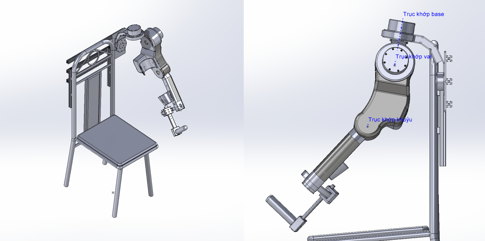
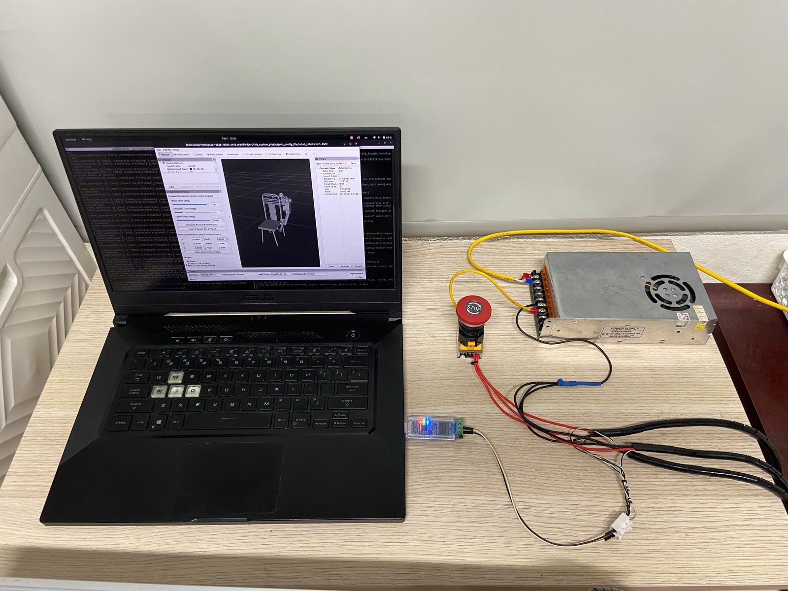
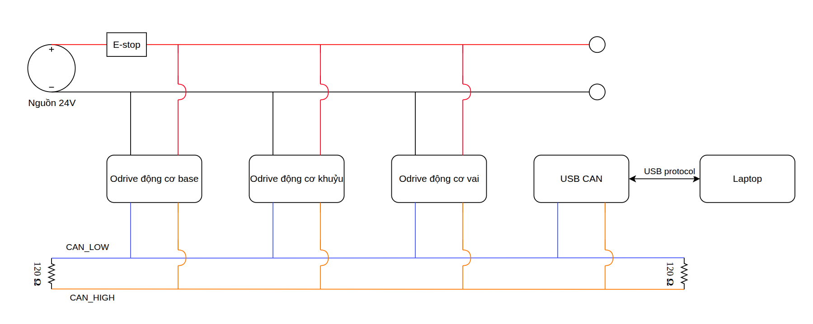
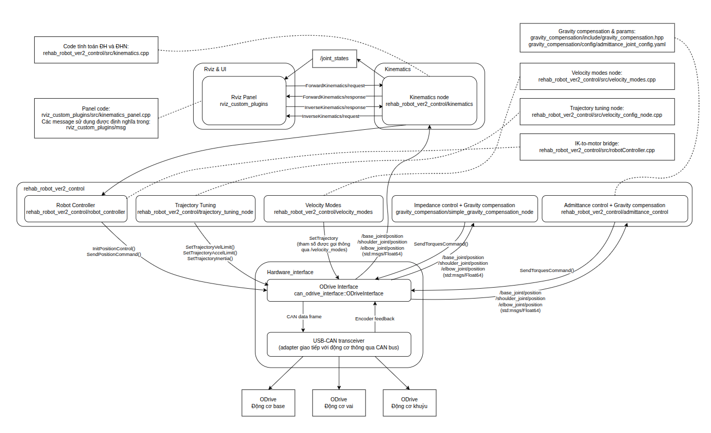
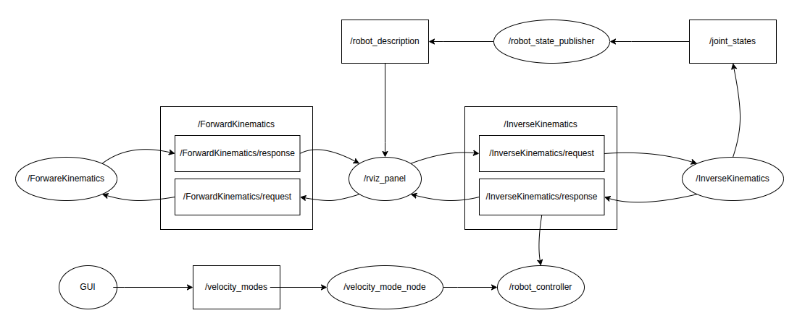
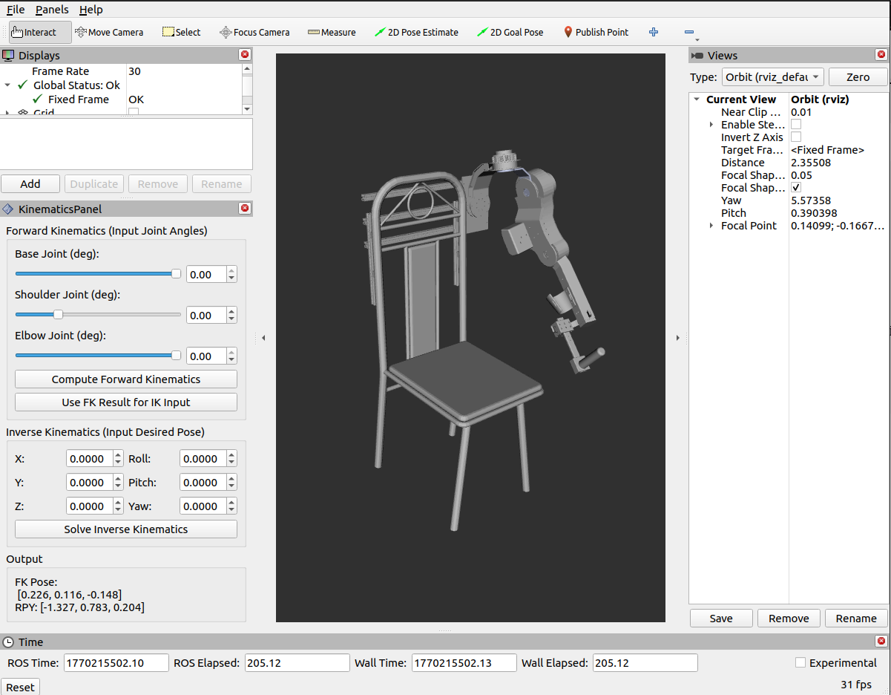
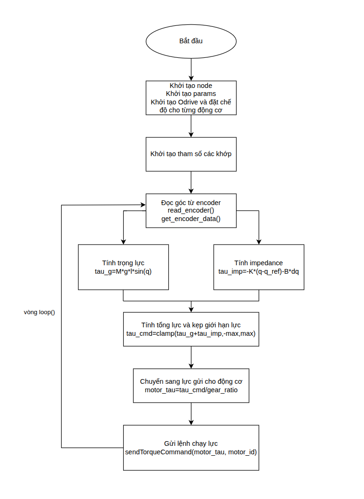
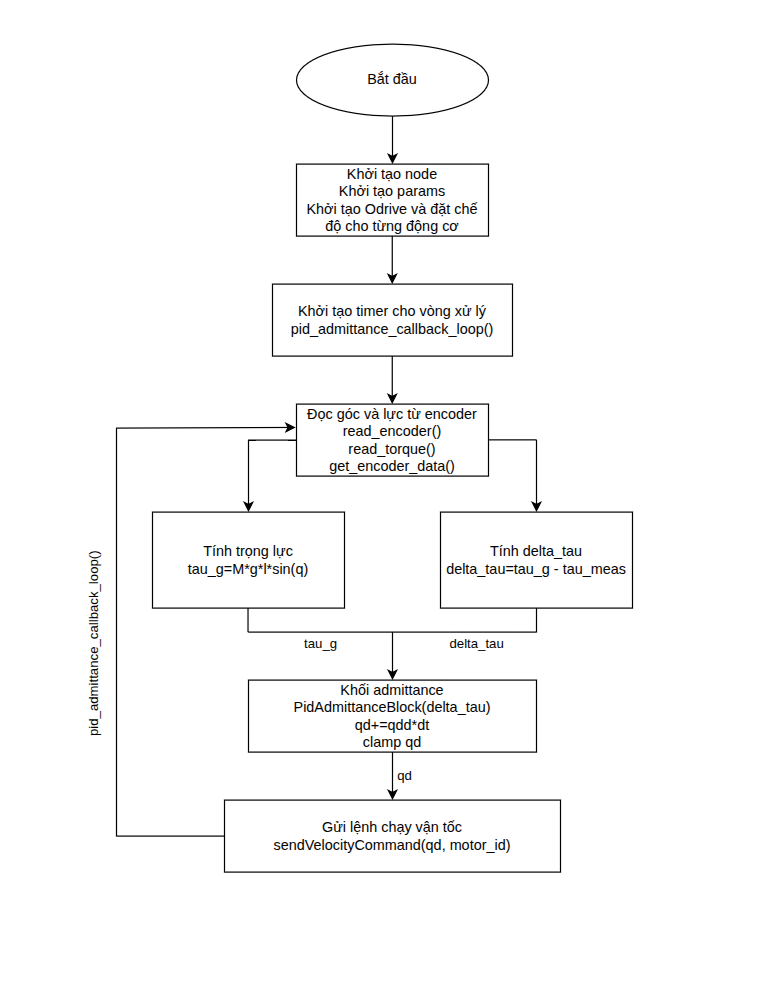
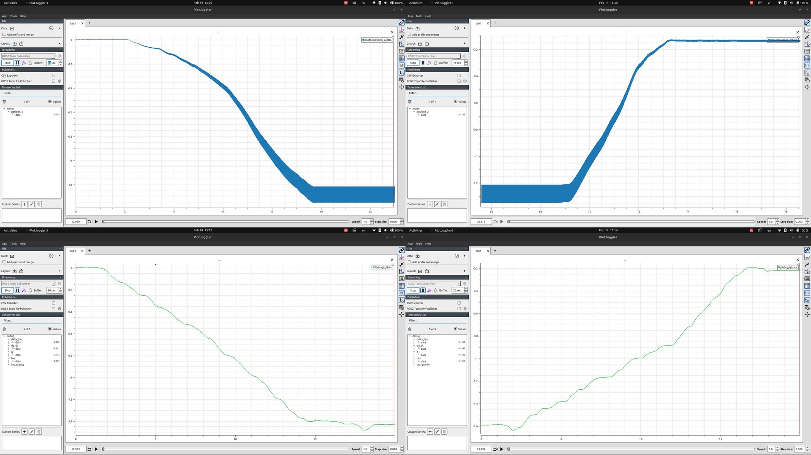

# Robot Phục Hồi Chức Năng Chi Trên 3 Bậc Tự Do với Điều Khiển Trở Kháng & Thuận Nạp

[English](README.md) | **Tiếng Việt**

> **Đồ án tốt nghiệp**: *Thiết kế và triển khai điều khiển Admittance cho robot phục hồi chức năng cánh tay*
> Ngành Cơ điện tử, Đại học Bách khoa Hà Nội (HUST), 03/2026


<p align="center">
  
  <br><em>Robot 3 DoF gắn trên khung đỡ liền ghế (trái) và vị trí các trục khớp base, vai, khuỷu (phải).</em>
</p>

---

## Tổng quan

Đột quỵ và các bệnh lý thần kinh thường làm suy giảm khả năng vận động của tay, và việc phục hồi đòi hỏi tập luyện lặp lại trong thời gian dài. Đồ án xây dựng một **robot cánh tay 3 bậc tự do chi phí thấp** hỗ trợ các bài tập cơ bản cho vai và khuỷu tay, với hai chế độ:

- **Chế độ thụ động:** robot đưa tay bệnh nhân đi theo quỹ đạo vận tốc hình thang, với ba mức tốc độ chậm / bình thường / nhanh.
- **Chế độ chủ động có hỗ trợ:** robot bù trọng lực và hoạt động như hệ khối lượng – lò xo – giảm chấn ảo. Hai bộ điều khiển tương tác được triển khai và so sánh trên phần cứng thật:
  - **Điều khiển trở kháng (Impedance, IC):** sai lệch vị trí → lệnh mô-men
  - **Điều khiển thuận nạp (Admittance, AC):** mô-men đo được → lệnh vận tốc

Mình tự thực hiện toàn bộ hệ thống: thiết kế cơ khí (SolidWorks), đi dây điện và mạng CAN, phần mềm ROS 2, thuật toán điều khiển và thực nghiệm với người dùng.

### Điểm nổi bật

- **Tự viết driver SocketCAN** cho ODrive bằng C++: chế độ vị trí, vận tốc, mô-men; giới hạn quỹ đạo; đọc encoder và mô-men.
- **Động học thuận và ngược** bằng KDL, dựng từ file URDF của robot.
- **Panel RViz 2 tự phát triển** (C++/Qt) để tính FK/IK trực quan và gửi vị trí đích xuống robot thật.
- **Bù trọng lực + điều khiển trở kháng / thuận nạp** cho từng khớp ở 100 Hz, mọi hệ số chỉnh qua YAML.
- **Giao diện bài tập cho bệnh nhân** (rqt / PyQt5): chọn bài tập, chỉnh tốc độ, bắt đầu hoặc dừng.
- **Giới hạn an toàn ở cả phần cứng lẫn phần mềm:** nút dừng khẩn cấp trên đường nguồn 24 V, kẹp giới hạn mô-men và vận tốc, giới hạn ROM của khớp.

## Phần cứng

<p align="center">
  
  
</p>

| Thành phần | Chi tiết |
|---|---|
| Cơ cấu chấp hành | 3 động cơ BLDC **GIM6010-8** có **hộp số tích hợp 8:1** (định mức 5 Nm, cực đại 11 Nm) |
| Driver | **ODrive** (điều khiển phân tầng vị trí → vận tốc → dòng điện), CAN node ID `0`/`1`/`2` = base/vai/khuỷu |
| Truyền thông | Bộ chuyển USB–CAN trên SocketCAN `can0`, **500 kbit/s**, điện trở đầu cuối 120 Ω ở hai đầu bus, cặp dây CAN_H/CAN_L xoắn đôi |
| Nguồn | Nguồn 24 VDC, **nút dừng khẩn cấp (E-stop)** trên đường nguồn chính |
| Cơ khí | Thiết kế cho tay trái, gắn trên khung ghế, dùng nhôm định hình kết hợp chi tiết gia công |

**Tầm vận động (ROM):** robot chỉ dùng khoảng 80% ROM lâm sàng để đảm bảo an toàn.

| Khớp | Động tác | ROM của robot | ROM an toàn sử dụng (≈80%) |
|---|---|---|---|
| Khuỷu | Gập (flexion) | ≈ 110° | ≈ 90° |
| Vai | Gập (flexion) | ≈ 110° | ≈ 90° |
| Vai | Duỗi (extension) | ≈ 25° | ≈ 20° |

## Kiến trúc phần mềm

<p align="center">
  
</p>

Luồng dữ liệu:

1. **Panel RViz** gửi yêu cầu FK/IK (message tự định nghĩa `KinematicsFKRequest` / `KinematicsIKRequest`).
2. **Node kinematics** giải bằng KDL, trả kết quả và publish `/joint_states`.
3. **Robot controller** chuyển nghiệm IK thành lệnh vị trí, với mức tốc độ do node **velocity modes** chọn.
4. **ODrive interface** đóng gói lệnh thành frame CAN, gửi qua `can0` và đọc phản hồi encoder, mô-men.
5. **Các node trở kháng và thuận nạp** bỏ qua nhánh điều khiển vị trí, gửi thẳng lệnh mô-men hoặc vận tốc.

<details>
<summary>Sơ đồ node cho chế độ thụ động</summary>
<p align="center"></p>
</details>

<p align="center">
  
  <br><em>Panel RViz tự phát triển: slider FK, nhập vị trí đích cho IK và mô hình robot cập nhật theo thời gian thực.</em>
</p>

## Điều khiển

Mọi bộ điều khiển chạy vòng lặp 100 Hz cho từng khớp. Góc khớp lấy từ encoder động cơ (số vòng động cơ ÷ tỉ số truyền), vận tốc được lọc thông thấp.

<table>
<tr>
<th width="50%">Điều khiển trở kháng → lệnh mô-men</th>
<th width="50%">Điều khiển thuận nạp → lệnh vận tốc</th>
</tr>
<tr>
<td>

```
τ_g   = m·g·l·sin(q)
τ_imp = −K·(q − q_ref) − B·q̇
τ_cmd = clamp(τ_g + τ_imp, ±τ_max)
motor_τ = τ_cmd / gear_ratio
```

`q_ref` tự bám theo tay khi khớp đứng yên, nên cánh tay "đứng lại ở chỗ bệnh nhân để".

</td>
<td>

```
τ_g  = m·g·l·sin(q)
Δτ   = τ_meas − τ_g        # mô-men tương tác
q̈_d  = (Δτ − B·q̇_d − K·e) / M
q̇_d += q̈_d·dt  →  clamp
```

Lực của bệnh nhân điều khiển một hệ khối lượng – giảm chấn – lò xo ảo, robot bám theo vận tốc sinh ra từ hệ đó.

</td>
</tr>
<tr>
<td></td>
<td></td>
</tr>
</table>

## Kết quả

Thực nghiệm trên **khớp khuỷu**, giới hạn chuyển động q ∈ [−90°, 0°], τ_max = 11 Nm, vận tốc thấp.

### Định lượng: đáp ứng vị trí khớp

<p align="center">
  
  <br><em>Trên: Impedance control (IC-High). Dưới: Admittance control (AC-High). Trái: đi lên. Phải: đi xuống.</em>
</p>

- **IC** đạt đích nhanh hơn, đường cong dạng S (pha tăng tốc và giảm tốc rõ ràng), giữ vị trí cuối ổn định.
- **AC** chuyển động gần tuyến tính và chậm hơn, hơi trôi và dao động nhẹ gần đích, rõ nhất khi đi lên ngược chiều trọng lực.

### Định tính: khảo sát người dùng (5 người, thang Likert 7 mức, giá trị trung bình)

| Tiêu chí | AC-High | IC-High | IC-Med | IC-Low |
|---|:-:|:-:|:-:|:-:|
| Mức gắng sức ↓ | 5 | **1** | 3 | 4 |
| Mức khó chịu ↓ | 3 | **2** | **2** | **2** |
| Cảm giác kiểm soát ↑ | 3 | 5 | **6** | **6** |
| Cảm giác an toàn ↑ | 5 | 6 | 6 | **7** |
| Độ mượt ↑ | 4 | 5 | 6 | **7** |

**Kết luận:** điều khiển trở kháng cho kết quả tốt hơn điều khiển thuận nạp ở hầu hết các tiêu chí. IC-High phù hợp khi bệnh nhân cần hỗ trợ mạnh. IC-Med và IC-Low cho cảm giác kiểm soát và độ mượt cao hơn, phù hợp với giai đoạn phục hồi chủ động.

## Cấu trúc thư mục

| Package | Ngôn ngữ | Mô tả |
|---|---|---|
| [`can_odrive_interface`](can_odrive_interface/) | C++ | Driver SocketCAN cho ODrive |
| [`rehab_robot_ver2`](rehab_robot_ver2/) | URDF | Mô tả robot (URDF xuất từ SolidWorks, mesh STL), file launch cho RViz và Gazebo |
| [`rehab_robot_ver2_control`](rehab_robot_ver2_control/) | C++ | Động học (KDL), robot controller, motor state publisher, chế độ vận tốc, điều khiển thuận nạp |
| [`gravity_compensation`](gravity_compensation/) | C++ | Node bù trọng lực + điều khiển trở kháng (Pinocchio / Eigen) |
| [`rviz_custom_plugins`](rviz_custom_plugins/) | C++ / Qt | Panel RViz 2 tính FK/IK và các message động học |
| [`my_rqt_plugin`](my_rqt_plugin/) | Python / PyQt5 | Giao diện chọn bài tập |
| [`rehab_gui`](rehab_gui/) | Python | Package giao diện (đang phát triển) |

## Cài đặt

### Yêu cầu

- Ubuntu 22.04, ROS 2 Humble
- `orocos_kdl`, `kdl_parser`, `pinocchio`, `Eigen3`, MoveIt core (dùng trong panel RViz), `rqt_gui_py`, PyQt5
- `can-utils` (không bắt buộc, dùng để debug mạng CAN)

### Build

```bash
mkdir -p ~/rehab_ws/src && cd ~/rehab_ws/src
git clone https://github.com/datnguyen1119/rehab_robot_ver2.git .
cd ~/rehab_ws
rosdep install --from-paths src --ignore-src -y
colcon build --symlink-install
source install/setup.bash

# Bật mạng CAN
sudo ip link set can0 up type can bitrate 500000
```

## Hướng dẫn sử dụng

### 1. Điều khiển vị trí bằng FK/IK trên RViz

```bash
ros2 launch rehab_robot_ver2_control controller_stateReader.launch.py   # động cơ + controller + kinematics
ros2 launch rviz_custom_plugins rviz_launch.launch.py                    # RViz kèm panel động học
```

- Kéo slider các góc khớp, rồi bấm **Compute Forward Kinematics** để cập nhật mô hình và tính vị trí đầu cuối.
- Bấm **Use FK Result for IK Input** để chuyển vị trí đó sang làm đích cho IK.
- Bấm **Solve Inverse Kinematics** để giải IK và gửi góc khớp xuống robot.

### 2. Tập thụ động với các mức tốc độ

```bash
ros2 run rehab_robot_ver2_control velocity_modes \
  --ros-args --params-file src/rehab_robot_ver2_control/config/trajectory_params.yaml
```

Các mức `slow` / `normal` / `fast` quy định giới hạn vận tốc, gia tốc, giảm tốc cho từng khớp trong [`trajectory_params.yaml`](rehab_robot_ver2_control/config/trajectory_params.yaml). Có thể chỉnh trực tiếp khi đang chạy:

```bash
ros2 param set /trajectory_tuning_node traj_vel_limit   [1.0,3.5]
ros2 param set /trajectory_tuning_node traj_accel_limit [1.0,5.0,5.0]
```

### 3. Điều khiển trở kháng + bù trọng lực

```bash
ros2 run gravity_compensation simple_gravity_compensation \
  --ros-args --params-file src/gravity_compensation/config/admittance_joint_config.yaml
```

Khối lượng, chiều dài khâu, hệ số giảm chấn, giới hạn mô-men và tỉ số truyền của từng khớp nằm trong [`admittance_joint_config.yaml`](gravity_compensation/config/admittance_joint_config.yaml).

### 4. Điều khiển thuận nạp + bù trọng lực (khớp khuỷu)

```bash
ros2 run rehab_robot_ver2_control node_gravity_compensation_elbow
ros2 param set /gravity_compensation_elbow_node mass_inertia 0.5
ros2 param set /gravity_compensation_elbow_node damping_coefficient 5.0
ros2 param set /gravity_compensation_elbow_node stiffness_coefficient 1.0
```

Ngoài ra còn có một phiên bản đơn giản cho nhiều khớp, xuất lệnh vị trí: `ros2 run rehab_robot_ver2_control admittance_control` (tham số `M_admittance`, `B_admittance`, `K_admittance`).

### 5. Giao diện bài tập

```bash
python3 -m my_rqt_plugin.app      # publish lệnh như "start_shoulder_flexion" lên /exercise_cmd
```

<details>
<summary>Công cụ debug</summary>

```bash
# Gửi lệnh mô-men trực tiếp
ros2 run rehab_robot_ver2_control torque_pub_node
ros2 topic pub /motor/torque_cmd std_msgs/msg/Float32 "{data: 0.1}"

# Thử điều khiển vận tốc
ros2 run rehab_robot_ver2_control simple_velocity_node
ros2 param set /simple_velocity_node target_velocity_1 1.5

# Vẽ đồ thị dữ liệu
ros2 run rehab_robot_ver2_control data_pub_node
ros2 run plotjuggler plotjuggler
```

`odrivetool`:

```python
odrv0.can.config.enable_r120 = True                     # bật điện trở đầu cuối CAN 120 Ω
odrv0.axis0.controller.config.control_mode = CONTROL_MODE_VELOCITY_CONTROL
odrv0.axis0.requested_state = AXIS_STATE_CLOSED_LOOP_CONTROL
```
</details>

## Hạn chế và hướng phát triển

- **Cơ khí:** giảm độ rơ và ma sát, tăng độ cứng vững và giảm khối lượng, bổ sung cơ cấu điều chỉnh theo nhân trắc.
- **Cảm biến:** thêm cảm biến lực/mô-men hoặc EMG thay vì ước lượng mô-men tương tác từ dòng động cơ.
- **Điều khiển:** quy trình tuning K, B, M có hệ thống; hỗ trợ theo nhu cầu (assist-as-needed) cá nhân hóa cho từng bệnh nhân; bù ma sát và dùng mô hình động lực học nhiều khâu; điều khiển trong không gian Descartes phối hợp nhiều khớp.
- **Phần mềm:** chuyển sang `ros2_control` và lifecycle node (đã có bản thử trong `*_lifecycle.cpp`), lưu lịch sử tập của bệnh nhân.
- Đồ án chưa thử nghiệm lâm sàng trên bệnh nhân.

## Tác giả

**Nguyễn Thành Đạt**, ngành Cơ điện tử, Đại học Bách khoa Hà Nội
Giảng viên hướng dẫn: TS. Nguyễn Xuân Thuận
GitHub: [@datnguyen1119](https://github.com/datnguyen1119)

## Giấy phép

Xem file `LICENSE` trong từng package.
