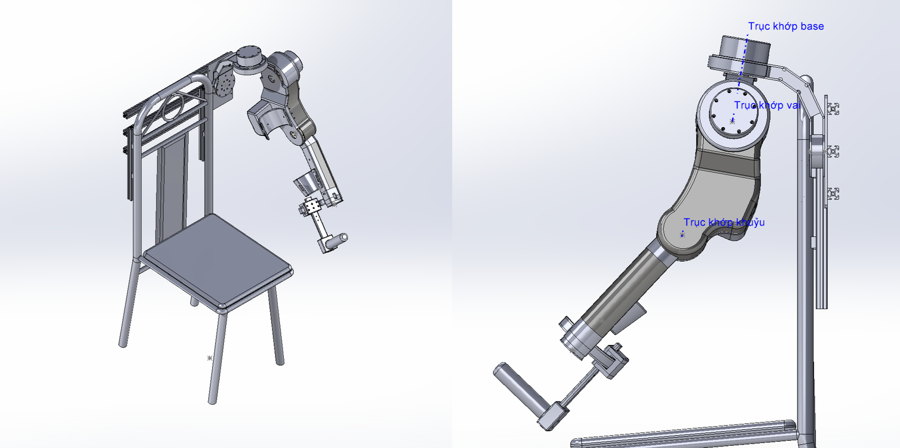
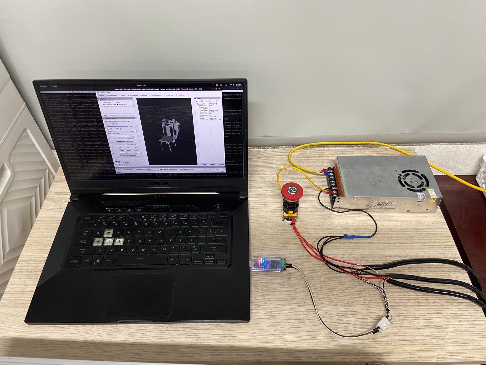
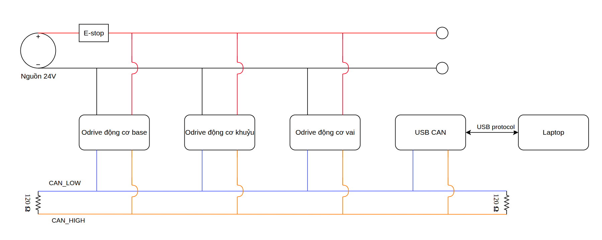
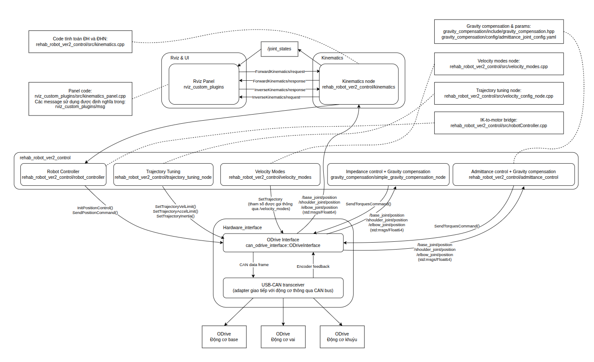
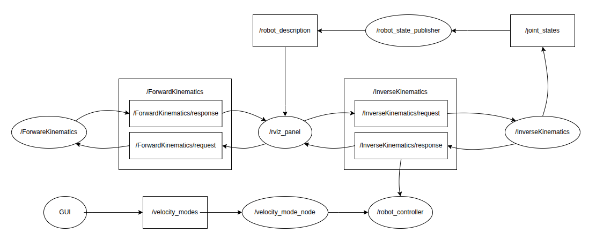
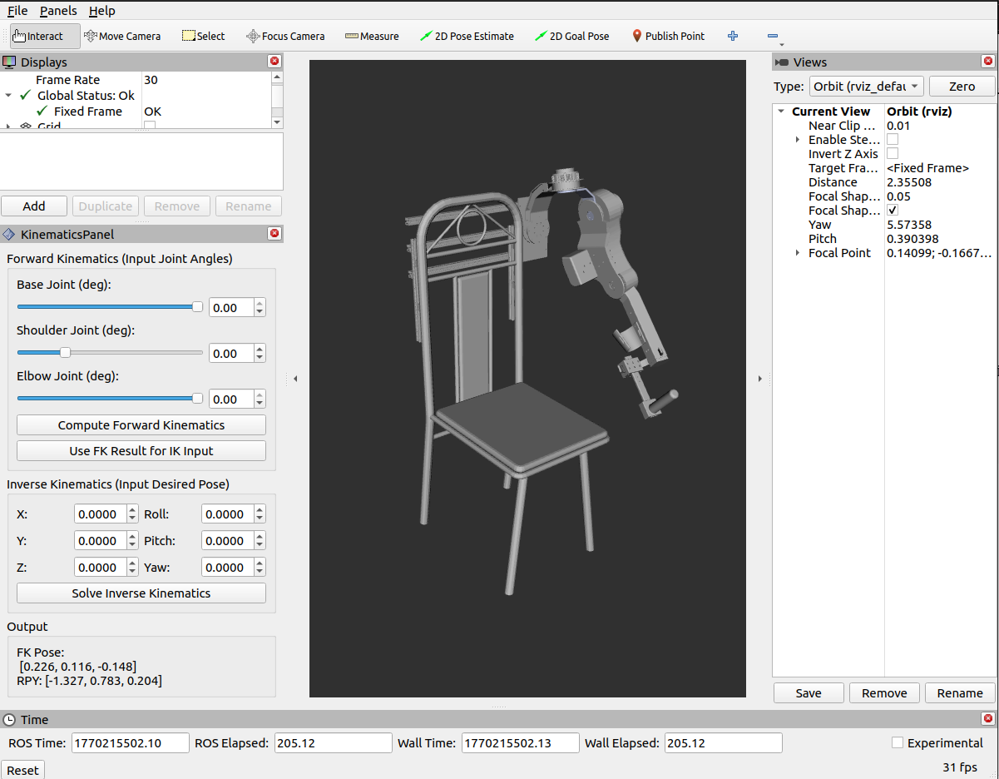
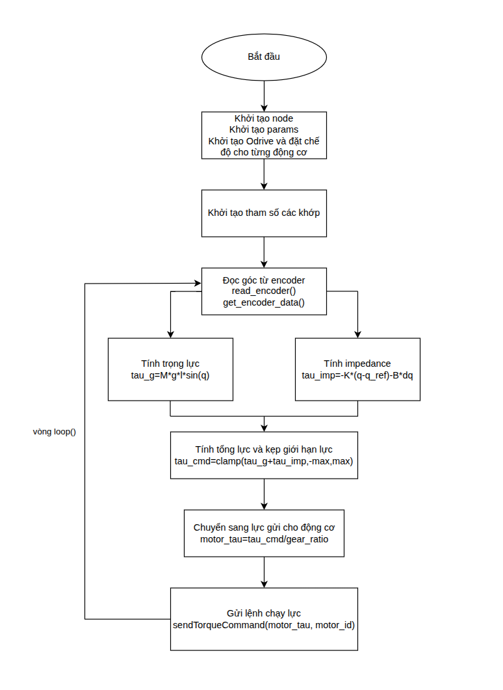
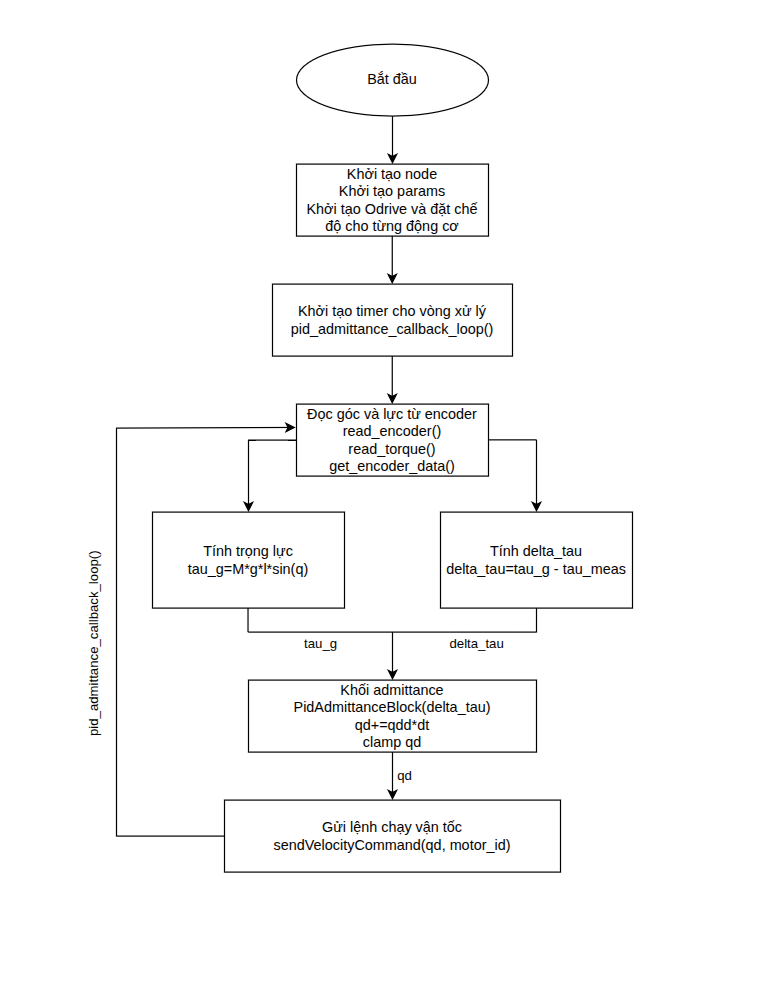
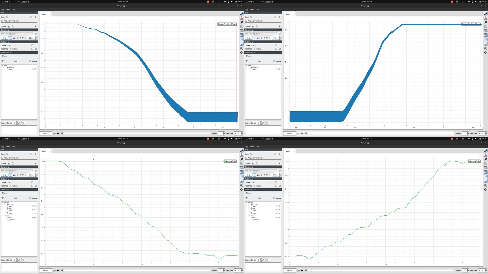

# 3-DOF Upper-Limb Rehabilitation Robot with Impedance & Admittance Control

**English** | [Tiếng Việt](README-vi.md)

> **Bachelor's graduation thesis**: *Design and Implementation of Admittance Control for an Upper-Limb Rehabilitation Robot*
> Mechatronics Engineering, Hanoi University of Science and Technology (HUST), 03/2026


<p align="center">
  
  <br><em>3-DOF robot mounted on a chair frame (left), and its base, shoulder and elbow axes (right).</em>
</p>

---

## Overview

Stroke and other neurological conditions often leave patients with reduced arm mobility, and recovery depends on long, repetitive therapy sessions. This project builds a **low-cost, 3-DOF arm robot** that supports basic shoulder and elbow exercises in two modes:

- **Passive mode:** the robot moves the patient's arm along a trapezoidal-velocity trajectory, at slow, normal or fast speed.
- **Active-assist mode:** the robot compensates for gravity and acts as a virtual mass–spring–damper. Two interaction controllers were implemented and compared on real hardware:
  - **Impedance control (IC):** position error → torque command
  - **Admittance control (AC):** measured torque → velocity command

I designed and built the whole system: mechanical design (SolidWorks), electrical wiring and the CAN network, the ROS 2 software stack, the control algorithms, and the experiments with users.

### Highlights

- **Custom SocketCAN driver** for ODrive motor controllers in C++: position, velocity and torque modes, trajectory limits, encoder and torque feedback.
- **Forward and inverse kinematics** with KDL, built from the robot's URDF.
- **Custom RViz 2 panel** (C++/Qt) to compute FK/IK interactively and send targets to the real robot.
- **Gravity compensation + impedance / admittance control** for each joint at 100 Hz, with every gain set in YAML.
- **Patient-facing exercise GUI** (rqt / PyQt5): pick an exercise, set the speed, start or stop.
- **Hardware and software safety limits:** E-stop on the 24 V supply line, torque and velocity clamping, joint ROM limits.

## Hardware

<p align="center">
  
  
</p>

| Component | Details |
|---|---|
| Actuators | 3 × **GIM6010-8** BLDC motors with integrated **8:1 gearbox** (5 Nm rated, 11 Nm peak) |
| Motor drivers | **ODrive** (cascaded position → velocity → current loops), CAN node IDs `0`/`1`/`2` = base/shoulder/elbow |
| Communication | USB–CAN adapter on SocketCAN `can0`, **500 kbit/s**, 120 Ω termination at both ends, twisted CAN_H/CAN_L pair |
| Power | 24 VDC supply, **emergency stop** on the main line |
| Mechanics | Left-arm design mounted on a chair frame, aluminium profiles plus machined parts |

**Range of motion:** the robot uses about 80% of the clinical ROM, for safety.

| Joint | Movement | Robot ROM | Safe ROM used (≈80%) |
|---|---|---|---|
| Elbow | Flexion | ≈ 110° | ≈ 90° |
| Shoulder | Flexion | ≈ 110° | ≈ 90° |
| Shoulder | Extension | ≈ 25° | ≈ 20° |

## Software architecture

<p align="center">
  
</p>

Data flow:

1. The **RViz panel** sends FK/IK requests (custom messages `KinematicsFKRequest` / `KinematicsIKRequest`).
2. The **kinematics node** solves them with KDL and publishes the result and `/joint_states`.
3. The **robot controller** turns the IK solution into position commands, using the speed preset chosen by **velocity modes**.
4. The **ODrive interface** packs commands into CAN frames, sends them over `can0` and reads encoder and torque feedback.
5. The **impedance and admittance nodes** bypass the position pipeline and send torque or velocity commands directly.

<details>
<summary>Passive-mode node graph</summary>
<p align="center"></p>
</details>

<p align="center">
  
  <br><em>Custom RViz panel: FK sliders, IK target pose and the live robot model.</em>
</p>

## Control

All controllers run a 100 Hz loop for each joint. Joint angles come from the motor encoders (motor turns ÷ gear ratio), and the velocity goes through a low-pass filter.

<table>
<tr>
<th width="50%">Impedance control → torque command</th>
<th width="50%">Admittance control → velocity command</th>
</tr>
<tr>
<td>

```
τ_g   = m·g·l·sin(q)
τ_imp = −K·(q − q_ref) − B·q̇
τ_cmd = clamp(τ_g + τ_imp, ±τ_max)
motor_τ = τ_cmd / gear_ratio
```

`q_ref` follows the arm once the joint stays still, so the arm "stays where the patient leaves it".

</td>
<td>

```
τ_g  = m·g·l·sin(q)
Δτ   = τ_meas − τ_g        # interaction torque
q̈_d  = (Δτ − B·q̇_d − K·e) / M
q̇_d += q̈_d·dt  →  clamp
```

The patient's torque drives a virtual mass–damper–spring, and the robot tracks the resulting velocity.

</td>
</tr>
<tr>
<td></td>
<td></td>
</tr>
</table>

## Results

Experiments were run on the **elbow joint**, with the motion limited to q ∈ [−90°, 0°], τ_max = 11 Nm, at low speed.

### Quantitative: joint position response

<p align="center">
  
  <br><em>Top: Impedance control (IC-High). Bottom: Admittance control (AC-High). Left: moving up. Right: moving down.</em>
</p>

- **IC** reaches the target faster, with an S-curve profile (clear acceleration and deceleration) and a stable hold at the end.
- **AC** moves almost linearly and more slowly, with slight drift and oscillation near the target, especially when moving up against gravity.

### Qualitative: user study (5 participants, 7-point Likert scale, mean values)

| Criterion | AC-High | IC-High | IC-Med | IC-Low |
|---|:-:|:-:|:-:|:-:|
| Effort ↓ | 5 | **1** | 3 | 4 |
| Discomfort ↓ | 3 | **2** | **2** | **2** |
| Sense of control ↑ | 3 | 5 | **6** | **6** |
| Feeling secure ↑ | 5 | 6 | 6 | **7** |
| Smoothness ↑ | 4 | 5 | 6 | **7** |

**Conclusion:** impedance control scored better than admittance control on almost every criterion. IC-High suits patients who need strong assistance. IC-Med and IC-Low give more sense of control and smoother motion, which suits the active recovery stage.

## Repository structure

| Package | Language | Description |
|---|---|---|
| [`can_odrive_interface`](can_odrive_interface/) | C++ | SocketCAN driver for ODrive |
| [`rehab_robot_ver2`](rehab_robot_ver2/) | URDF | Robot description (URDF exported from SolidWorks, STL meshes), RViz and Gazebo launch files |
| [`rehab_robot_ver2_control`](rehab_robot_ver2_control/) | C++ | Kinematics (KDL), robot controller, motor state publisher, velocity modes, admittance control |
| [`gravity_compensation`](gravity_compensation/) | C++ | Gravity compensation + impedance control node (Pinocchio / Eigen) |
| [`rviz_custom_plugins`](rviz_custom_plugins/) | C++ / Qt | RViz 2 FK/IK panel and the custom kinematics messages |
| [`my_rqt_plugin`](my_rqt_plugin/) | Python / PyQt5 | Exercise selection GUI |
| [`rehab_gui`](rehab_gui/) | Python | GUI package (work in progress) |

## Getting started

### Requirements

- Ubuntu 22.04, ROS 2 Humble
- `orocos_kdl`, `kdl_parser`, `pinocchio`, `Eigen3`, MoveIt core (used by the RViz panel), `rqt_gui_py`, PyQt5
- `can-utils` (optional, for debugging the CAN bus)

### Build

```bash
mkdir -p ~/rehab_ws/src && cd ~/rehab_ws/src
git clone https://github.com/datnguyen1119/rehab_robot_ver2.git .
cd ~/rehab_ws
rosdep install --from-paths src --ignore-src -y
colcon build --symlink-install
source install/setup.bash

# Bring up the CAN bus
sudo ip link set can0 up type can bitrate 500000
```

## Usage

### 1. Position control with FK/IK from RViz

```bash
ros2 launch rehab_robot_ver2_control controller_stateReader.launch.py   # motors + controller + kinematics
ros2 launch rviz_custom_plugins rviz_launch.launch.py                    # RViz with the kinematics panel
```

- Move the joint sliders, then press **Compute Forward Kinematics** to update the model and compute the end-effector pose.
- Press **Use FK Result for IK Input** to copy that pose into the IK target.
- Press **Solve Inverse Kinematics** to compute IK and send the joint targets to the robot.

### 2. Passive training with speed presets

```bash
ros2 run rehab_robot_ver2_control velocity_modes \
  --ros-args --params-file src/rehab_robot_ver2_control/config/trajectory_params.yaml
```

The presets (`slow` / `normal` / `fast`) set velocity, acceleration and deceleration limits for each joint in [`trajectory_params.yaml`](rehab_robot_ver2_control/config/trajectory_params.yaml). You can also tune them at runtime:

```bash
ros2 param set /trajectory_tuning_node traj_vel_limit   [1.0,3.5]
ros2 param set /trajectory_tuning_node traj_accel_limit [1.0,5.0,5.0]
```

### 3. Impedance control + gravity compensation

```bash
ros2 run gravity_compensation simple_gravity_compensation \
  --ros-args --params-file src/gravity_compensation/config/admittance_joint_config.yaml
```

Mass, link length, damping, torque limit and gear ratio for each joint are set in [`admittance_joint_config.yaml`](gravity_compensation/config/admittance_joint_config.yaml).

### 4. Admittance control + gravity compensation (elbow)

```bash
ros2 run rehab_robot_ver2_control node_gravity_compensation_elbow
ros2 param set /gravity_compensation_elbow_node mass_inertia 0.5
ros2 param set /gravity_compensation_elbow_node damping_coefficient 5.0
ros2 param set /gravity_compensation_elbow_node stiffness_coefficient 1.0
```

A simpler multi-joint variant that outputs position commands is also available: `ros2 run rehab_robot_ver2_control admittance_control` (parameters `M_admittance`, `B_admittance`, `K_admittance`).

### 5. Exercise GUI

```bash
python3 -m my_rqt_plugin.app      # publishes e.g. "start_shoulder_flexion" on /exercise_cmd
```

<details>
<summary>Debugging tools</summary>

```bash
# Direct torque command
ros2 run rehab_robot_ver2_control torque_pub_node
ros2 topic pub /motor/torque_cmd std_msgs/msg/Float32 "{data: 0.1}"

# Velocity test
ros2 run rehab_robot_ver2_control simple_velocity_node
ros2 param set /simple_velocity_node target_velocity_1 1.5

# Plot data
ros2 run rehab_robot_ver2_control data_pub_node
ros2 run plotjuggler plotjuggler
```

`odrivetool`:

```python
odrv0.can.config.enable_r120 = True                     # enable the 120 Ω CAN termination
odrv0.axis0.controller.config.control_mode = CONTROL_MODE_VELOCITY_CONTROL
odrv0.axis0.requested_state = AXIS_STATE_CLOSED_LOOP_CONTROL
```
</details>

## Limitations and future work

- **Mechanics:** reduce backlash and friction, make the structure stiffer and lighter, add adjustments for different body sizes.
- **Sensing:** add a force/torque sensor or EMG instead of estimating interaction torque from motor current.
- **Control:** systematic tuning of K, B, M; assist-as-needed control personalised to each patient; friction compensation and a multi-link dynamic model; Cartesian-space control across several joints.
- **Software:** move to `ros2_control` and lifecycle nodes (prototypes are in `*_lifecycle.cpp`), log patient progress.
- Clinical trials on patients were out of the scope of this thesis.

## Author

**Nguyễn Thành Đạt**, Mechatronics Engineering, HUST
Supervisor: Dr. Nguyễn Xuân Thuận
GitHub: [@datnguyen1119](https://github.com/datnguyen1119)

## License

See the `LICENSE` file in each package.
